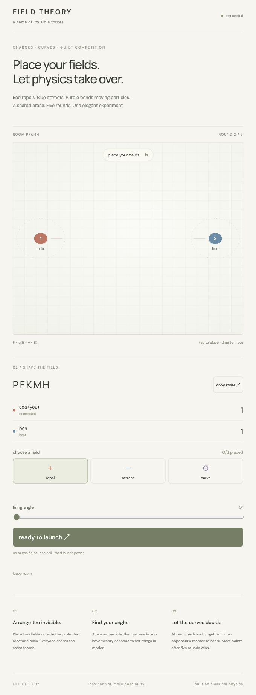

# FIELD THEORY

A minimalist, account-free multiplayer game of invisible forces. Steer a continuous charged-particle stream by aiming your cannon and moving electromagnetic fields while the action unfolds.

**[Play FIELD THEORY](https://field-theory.packedbasil2.chatgpt.site)** · **[Public MIT source](https://github.com/ilinus247/field-theory)**

Backend: https://field-theory.onrender.com



## Rules and controls

Create a room with your display name and share its code or URL with 1–3 friends. The host starts when at least two players are connected. There are **three rounds**, each with **8 seconds of setup**, **60 seconds of live play**, and a short results break. Ready players can start early.

Your cannon fires automatically throughout live play. Aim with the slider, or select **aim cannon** and drag anywhere in the arena. Select a field type and tap to place; drag your own fields to move them and use their × buttons to remove them. You may add, move, and remove fields throughout the minute. Two field slots per player, with at most one magnetic coil. Protected reactor circles reject placement.

- **Red +** repels positive particles.
- **Blue −** attracts positive particles.
- **Violet ⊙** curves moving particles.
- All players share the combined fields. Rival positive streams weakly repel one another.
- Solid dark outlines and **you** labels identify your fields. Player-number badges and owner labels identify every generator without confusing ownership with charge polarity.

Keep your stream hitting opposing reactors to earn **pressure seconds**. The server maintains contact for 0.23 seconds after an impact to bridge the normal spacing between emitted particles. Continuous contact earns one point per second per opposing reactor. Friendly hits score nothing; shields block incoming scoring. Double score increases the rate to two. Scores accumulate across rounds; displayed tenths determine ties. The host can start a rematch.

The in-game **how to play** button opens the full rules and booster guide without leaving the room.

### Labeled boosters

A pickup appears after six seconds, then approximately every eight seconds. At most two are present. Hit one with a particle to collect it; it disappears immediately. Pickups expire after ten seconds. Effects last six seconds, refresh instead of stacking, and reset each round.

| Pickup | Target | Effect |
|---|---|---|
| rapid fire | collector | emission interval 0.2 → 0.1 seconds |
| double score | collector | twice the pressure score |
| shield | collector | incoming contact cannot score |
| slow rivals | other players | doubles their emission interval |
| weak fields | other players | reduces their generators to 45% strength |
| aim drift | other players | sinusoidal cannon wobble of about ±8° |

## Architecture

**Frontend:** React, TypeScript, Vite, HTML Canvas, responsive CSS, mouse/pointer/touch controls, a native modal rules dialog, stronger electric streamlines, magnetic rings, owner labels, interpolated live particles and trails, pickup labels, and effect countdowns.

**Backend:** Python, FastAPI, Uvicorn, WebSockets, and **JAX CPU**. One process manages independent rooms with in-memory state. No database or accounts.

**Authority:** the server accepts bounded live control updates, advances the shared physics, detects swept collisions and pickups, applies effects, and awards time-based scores. At 10 Hz it broadcasts a sequenced authoritative snapshot containing particle slots, positions, owner indices, contact, effects, and scores. Clients interpolate snapshots with a 100 ms visual buffer; they never compute authoritative outcomes. Controls are coalesced to 12.5 Hz in the browser and applied at most once per server tick. Delayed control bursts replace obsolete inputs rather than generating slowdown errors. Each connection has one pending snapshot and a dedicated writer, so a slow viewer cannot block room physics or be disconnected by a brief 200 ms delay. Browser backpressure keeps only the newest unsent controls. Match, round, and monotonically increasing input sequence checks reject stale controls, including after rematches.

**Rooms:** 2–4 players, 16-room cap, random codes and private reconnect tokens, tab-scoped identities that survive refresh, host transfer, input size/rate limits, and five-minute cleanup of abandoned rooms. Disconnected cannons stop emitting. Empty-room simulation pauses to save CPU; reconnecting resumes it. A process restart discards all rooms.

## Physics and JAX

Normalized coordinates use gameplay units and q/m = 1:

```text
F = q(E + v × B)
Eᵢ(r) = kQᵢ(r − rᵢ) / (|r − rᵢ|² + ε²)^(3/2)
Bz(r) = B₀ exp(−|r − rc|² / (2σ²))
```

The live engine in `backend/app/physics/streams.py` uses **120 Hz Boris integration**, compiled with `jax.jit`. `jax.vmap` batches field evaluation; `jax.lax.scan` advances twelve fixed steps per 100 ms batch. The fixed pool has **128 slots (32 per player)** and eight generator slots, avoiding recompilation as the arena changes. Particle lifetime is three seconds; maximum normal rapid fire fits in the pool. Float64, softened fields, acceleration/speed bounds, and swept segment-circle collision checks keep behavior finite and prevent tunneling.

Opposing streams interact through a softened pairwise electric repulsion with k = 0.000035 and softening 0.025. Same-owner particles do not repel one another; this is an intentional stream-coherence/gameplay approximation. There are no hard particle-particle collisions. External fields retain k = 0.018, ε = 0.065, B₀ = 5, σ = 0.16. Initial particle speed is 0.42, capped at 1.4. Magnetic-only Boris rotation preserves speed to numerical precision. These are gameplay approximations, not a Maxwell-equation solver.

The historical single-projectile NumPy/JAX modules remain as tested numerical references; **live multiplayer always uses JAX**, with no silent downgrade. `/health` reports the live engine, compilation time, peak process memory, and most recent room tick time.

## Local development

Use Python 3.10+ (deployment targets 3.12) and Node 22+.

```sh
python3 -m venv .venv
. .venv/bin/activate
pip install -r backend/requirements.txt
cd backend
uvicorn app.main:app --reload --port 8000
```

From a second terminal at repository root:

```sh
npm --prefix frontend ci
npm --prefix frontend run dev
```

Open http://localhost:5173 in two tabs, choose different names, and join the same room. Each tab has its own identity in session storage. Refresh preserves identity; copying a tab may copy that identity and replace its old socket.

## Tests

```sh
pip install pytest httpx websockets
(cd backend && python -m pytest -q)
npm --prefix frontend test
npm --prefix frontend run build
python tests/live_smoke.py
python tests/network_recovery.py
```

The automated suite covers physics, energy conservation, pairwise repulsion, bounded deterministic emission, sustained scoring, shields and double score, swept pickup collection, all six booster targets, live controls, stale input, validation, multiplayer snapshots, three-round progression, rematches, reconnection, and independent rooms. The live smoke test runs three actual 60-second rounds over WSS and compares authoritative snapshots from two clients while changing controls during play. It creates disposable test rooms and takes a few minutes.

[Verification record](docs/VERIFICATION.md) distinguishes executed checks from unverified cases. CI runs backend tests and the TypeScript/Vite production build.

## Deployment

The frontend is published through **ChatGPT Sites**, as requested. `.openai/hosting.json` identifies the existing Site and its top-level `dist` build. Build with `VITE_BACKEND_URL` set to the public HTTPS backend before packaging. Sites maintains a managed source mirror; GitHub is the public MIT source of record. Publish both from the same release revision.

The backend is a **Render Free** web service built from GitHub `main`. `render.yaml` records the build, one-worker startup command, `/health`, and allowed frontend origin. Bind to `0.0.0.0` and Render's supplied `$PORT`. No database, disk, or paid resources are needed. The public-URL Git import requires manual deployment; connect Render's GitHub integration for future automatic deploys. Always verify the live deployment's commit.

A `vercel.json` remains available as an alternative frontend deployment configuration; the current frontend uses Sites.

| Variable | Where | Meaning |
|---|---|---|
| `VITE_BACKEND_URL` | frontend build | public HTTPS backend origin; local default is http://localhost:8000 |
| `ALLOWED_ORIGINS` | backend | comma-separated exact allowed frontend origins |
| `PORT` | backend | Render-provided listening port |
| `JAX_PLATFORMS` | backend | `cpu` |
| `OMP_NUM_THREADS` | backend | `1` |

See `.env.example`. The backend URL is intentionally public and grants no administrative access. Hosting credentials and player reconnect tokens must stay private and must never be committed.

## Limits and costs

Render Free sleeps after idle periods, can take about a minute to wake, and discards rooms on restart. The client shows connection state and retries. JAX warms before the service accepts gameplay. CPU and monthly bandwidth limits still apply; sustained multi-room load is not certified. Pairwise interactions and particle counts are deliberately bounded. Physical phones and a forced idle-wake cycle still require additional verification.

The service remains on the Free plan. No payment information, paid upgrade, database, disk, GPU, or domain was added. Do not enable paid overages or upgrades for this project.

## License

MIT. Copyright © 2026 ilinus247. See [LICENSE](LICENSE).

### Arena selection and curve balance

The host selects **open field**, **lens garden**, or **eddy court** in the lobby.
The selection is locked for all three rounds, and can be changed before a rematch.
Arena fixtures are shared and fixed; they do not consume player field slots.

Lens garden contains two Gaussian attraction wells (radius parameter 0.075).
Their conservative electric field is `E = -0.9 d / σ exp(-|d|² / 2σ²)`.
Eddy court contains opposite-sign Gaussian magnetic vortices (`B₀ = ±2`,
`σ = 0.085`), integrated with the same energy-preserving Boris rotation.
The drawn circles mark protected placement areas, not hard field cutoffs.
Player coils now use `B₀ = 2.5` and `σ = 0.11` in live play, down from
5 and 0.16: half the peak strength with a narrower reach. The original
one-shot reference engines retain their historical parameters.
